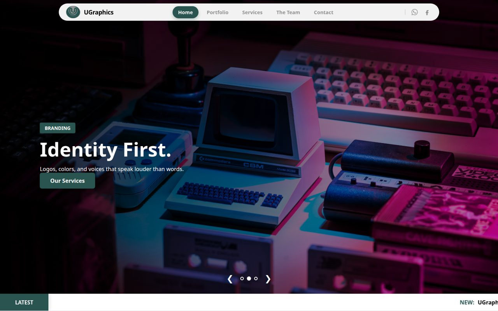

<div align="center">

# 🎨 UGraphics — Creative Design Agency Website

### A bold, image-led marketing site for a branding & design studio

[](https://smuhammadbilalh.github.io/ugraphics/)
[](#)
[](#)
[](#)

<a href="https://smuhammadbilalh.github.io/ugraphics/"></a>

</div>

---

## 📖 About

**UGraphics** is a web presence for a creative agency offering logo design, UI/UX, video editing and social-media marketing. The site is built to *sell* — full-bleed hero slider, strong typography, stats that build trust, a portfolio grid and clear calls to action.

## ✨ Features

- 🖼️ **Full-screen hero slider** with per-slide badge, headline and CTA
- 📣 **Announcement ticker** for offers, launches and hiring notices
- 📊 **Trust stats** (projects, clients, brands) and a services grid
- 🗂️ **Portfolio page** driven by `projects.json` — add a project without touching HTML
- 👥 **Team carousel** and a **developer / contact** page
- 📱 **Responsive** layout with a mobile drawer menu
- ⚡ **No frameworks, no build** — just HTML + CSS, deployed to GitHub Pages

## 🗂️ Structure

```
ugraphics/
├── index.html        # Home — hero, ticker, stats, services, team
├── portfolio.html    # Work grid (reads projects.json)
├── services.html
├── contact.html
├── developers.html
├── projects.json     # Portfolio data
├── css/
├── Images/  Videos/
└── Web.config        # IIS hosting support
```

## ⚡ Run Locally

```bash
git clone https://github.com/smuhammadbilalh/ugraphics.git
cd ugraphics
python3 -m http.server 8080   # then open http://localhost:8080
```

---

## 👨‍💻 Author

<div align="center">

**Muhammad Bilal** — IT Specialist & App Developer · Gujrat, Pakistan

[](https://github.com/smuhammadbilalh)
[](https://www.linkedin.com/in/muhammadbilaltech)
[](mailto:smuhammadbilalh@gmail.com)

⭐ If this project helped you, please consider giving it a star!

</div>
